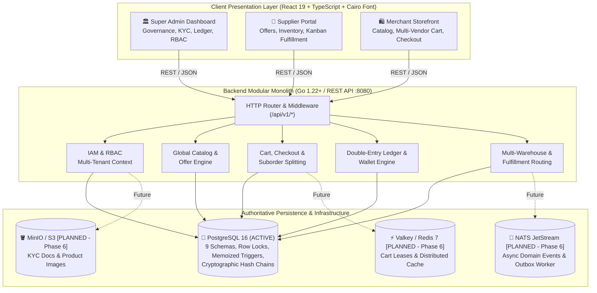

# 🌐 NEXUS Marketplace Core — Enterprise Operating System
### Reusable Modular Monolith Core Engine for Multi-Vendor B2B & B2C Marketplaces

[](https://golang.org)
[](https://react.dev)
[](https://www.typescriptlang.org)
[](https://www.postgresql.org)
[-0d9488?style=flat)](https://fonts.google.com/specimen/Cairo)
[](#license)

---

## 📖 Overview

**NEXUS Marketplace Core** is an enterprise-grade, high-performance marketplace engine built to serve as a **reusable platform core**. Instead of building marketplaces from scratch, this repository is designed to be **forked or cloned** to launch complete, production-ready platforms for any industry vertical (Wholesale B2B, Retail B2C, Quick Commerce, Industrial Spare Parts, or On-Demand Services).

### Key Architectural Highlights:
- **3 Fully Functional Portals** in a unified React 19 SPA with zero mock dependencies:
  1. 🏛️ **Super Admin Dashboard**: Full platform governance, compliance/KYC, catalog moderation, double-entry financial ledger, CMS homepage builder, RBAC, and immutable audit trails.
  2. 🏢 **Seller / Supplier Portal**: Operations overview, catalog offer management, tiered bulk pricing, multi-warehouse stock allocation, order fulfillment pipeline (Kanban), and earnings wallet.
  3. 🛍️ **Merchant Storefront (Website)**: Multi-supplier catalog discovery, real-time offer matrix comparison for the same product, split suborder shopping cart, and escrow-backed wallet checkout.
- **Native Arabic RTL & English LTR**: Pixel-perfect bidirectional layouts powered by Google Font **`Cairo`** (weights 300 to 900), instant language switching, and bidirectional icon mirroring.
- **Strict Financial Integrity**: Native double-entry accounting engine where $\sum \text{Debits} = \sum \text{Credits}$ is enforced by database triggers and cryptographic hash chains.
- **Shared Global Catalog**: Strict separation between the canonical product definition (`catalog.products`) and supplier commercial terms (`catalog.supplier_offers`), enabling multiple vendors to compete on the same product listing.
- **Parent Order & Suborder Splitting**: Automatically groups multi-vendor checkout carts into 1 Parent Order and $N$ isolated Supplier Suborders with separate logistics fees and fulfillment statuses.

---

## 🏛️ System Architecture



---

## ⚡ Quick Start (Local Development)

### Prerequisites:
- **Go 1.22+** (Backend)
- **Node.js 20+** & npm (Frontend)
- **PostgreSQL 16** (Database)
- *Optional:* Docker Compose (for complete containerized stack)

### 1. Clone Repository & Setup Environment
```bash
git clone <your-github-repo-url> marketplace-core
cd marketplace-core

# Copy environment templates
cp .env.example .env
cp backend/.env.example backend/.env
cp "Marketplace Admin Dashboard/.env.example" "Marketplace Admin Dashboard/.env"
```

### 2. Start PostgreSQL & Run Migrations
If using local PostgreSQL:
```bash
# Create database
createdb -U postgres marketplace_core

# Apply migrations and seed data (12 migrations)
psql -U postgres -d marketplace_core -f backend/db/migrations/000001_iam_schema.up.sql
psql -U postgres -d marketplace_core -f backend/db/migrations/000002_catalog_schema.up.sql
psql -U postgres -d marketplace_core -f backend/db/migrations/000003_commerce_schema.up.sql
psql -U postgres -d marketplace_core -f backend/db/migrations/000004_ledger_schema.up.sql
psql -U postgres -d marketplace_core -f backend/db/migrations/000005_platform_schema.up.sql
psql -U postgres -d marketplace_core -f backend/db/migrations/000006_inventory_schema.up.sql
psql -U postgres -d marketplace_core -f backend/db/migrations/000007_fulfillment_schema.up.sql
psql -U postgres -d marketplace_core -f backend/db/migrations/000008_auth_cart_cms_schema.up.sql
psql -U postgres -d marketplace_core -f backend/db/migrations/000009_ledger_trigger.up.sql
psql -U postgres -d marketplace_core -f backend/db/migrations/000010_iam_system_roles.up.sql
psql -U postgres -d marketplace_core -f backend/db/migrations/000011_financial_enhancements.up.sql
psql -U postgres -d marketplace_core -f backend/db/migrations/000012_ledger_integrity.up.sql

# Load baseline system roles & configurations (required for all environments)
psql -U postgres -d marketplace_core -f backend/db/seeds/system_seed.sql

# Load demo suppliers, products, and merchants (development only)
psql -U postgres -d marketplace_core -f backend/db/seeds/demo_seed.sql
```

*Or spin up via Docker Compose in one command:*
```bash
docker compose -f deploy/docker-compose.yml up -d
```

### 3. Launch Backend API (Go)
```bash
cd backend
go run ./cmd/api
# API listening at http://localhost:8080
# Health check: http://localhost:8080/health
```

### 4. Launch Frontend (Vite + React)
```bash
cd "Marketplace Admin Dashboard"
npm install
npm run dev
# Vite dev server running at http://localhost:5173
```

---

## 🔱 Spawning a New Business Fork (White-Label Generator)

When you need to spin up a completely new marketplace for a client or vertical, use the automated fork initializer:

### On Windows (PowerShell):
```powershell
.\scripts\create-fork.ps1 -Name "BasketPort" -Slug "basketport" -Preset "b2b_wholesale" -Currency "SAR" -Locale "ar" -OutputDir "E:\BasketPort"
```

### On Linux / macOS (Bash):
```bash
chmod +x scripts/create-fork.sh
./scripts/create-fork.sh "BasketPort" "basketport" "b2b_wholesale" "SAR" "ar" "../BasketPort"
```

### Supported Business Presets:
| Preset | Target Market | Key Feature Flags |
| :--- | :--- | :--- |
| `b2b_wholesale` | B2B Wholesale, Building Materials, FMCG | MOQ active, Tiered quantity pricing, Escrow held, RFQ quotes |
| `b2c_retail` | Multi-Brand Fashion, Consumer Electronics | MOQ off, 1-click credit card checkout, Verified user reviews |
| `food_grocery` | Hyperlocal Food, Grocery, Quick Commerce | Multi-warehouse dark stores, Short lead times, Auto-dispatch |
| `services_custom`| Professional Freelancing, Contracting | Milestone-based escrow payments, Tailored RFQ quotations |

---

## 📦 Core Business Modules

| Module | Schema / Path | Description |
| :--- | :--- | :--- |
| **IAM & RBAC** | `iam.*` | Tenant isolation, RBAC role permission resolution, 2FA tokens. |
| **Global Catalog** | `catalog.products` | Canonical product specifications, taxonomy tree (248 categories). |
| **Supplier Offers** | `catalog.supplier_offers` | Multi-vendor offers, lead times, MOQ thresholds, tiered pricing. |
| **Order Engine** | `orders.*` | Parent order creation, automated suborder splitting per supplier. |
| **Double-Entry Ledger** | `ledger.*` | Append-only journal entries (`DR` = `CR`), cryptographic hashes. |
| **Escrow & Wallets** | `ledger.accounts` | Buyer deposits, held dispute escrow, supplier settlement payouts. |
| **Commission Engine** | `platform.commission_rules`| Hierarchical resolution: Supplier Agreement > Category > Global Rate. |
| **Multi-Warehouse** | `inventory.*` | Multi-facility inventory, stock reservations with TTL expiration. |
| **Fulfillment Pipeline**| `fulfillment.*` | Suborder packaging slips, carrier tracking (SMSA, Aramex, DHL). |
| **Storefront CMS** | `platform.cms_sections` | Drag-and-drop homepage layout builder, bilingual banner copy. |

---

## 📡 REST API Reference

The backend exposes RESTful endpoints with consistent JSON envelopes under `/api/v1/`:

```
GET    /api/v1/products             # List global catalog with offer counts and min prices
GET    /api/v1/products/:id         # Get product detail with specs and category
GET    /api/v1/products/:id/offers  # Get all active supplier offers & tiers for a product
POST   /api/v1/cart/checkout        # Multi-vendor checkout with suborder splitting & wallet debit
GET    /api/v1/orders               # List parent orders and nested suborders
PATCH  /api/v1/orders/suborders/:id # Update fulfillment status (packing, shipped, delivered)
GET    /api/v1/ledger/entries       # View cryptographic double-entry journal records
GET    /api/v1/admin/suppliers      # Supplier onboarding & KYC verification queue
POST   /api/v1/admin/suppliers/:id  # Approve / Reject supplier KYC status
GET    /api/v1/commission/rules     # View active commission rules and override hierarchy
GET    /api/v1/config/features      # Dynamic feature flags query
```

---

## 🚀 Setting Up on GitHub

To push this master core engine to your own GitHub organization:

```bash
# 1. Initialize git on main branch (if not already set)
git branch -M main

# 2. Add your GitHub repository remote
git remote add origin https://github.com/<your-username-or-org>/marketplace-core.git

# 3. Push complete codebase with tags
git push -u origin main
```

### Syncing Upstream Improvements to Client Forks:
When core platform enhancements or security fixes are made in `marketplace-core`, merge them into downstream client forks:
```bash
cd ../my-client-marketplace
git fetch upstream
git merge upstream/main
```

---

## 📄 License
Proprietary & Confidential — All rights reserved. Created for enterprise marketplace deployments.
