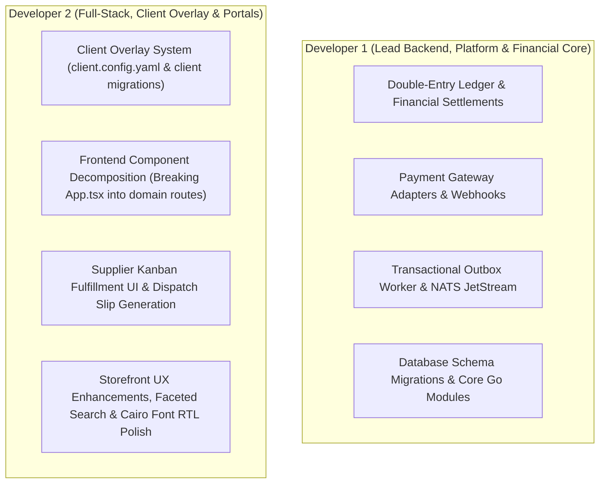

# NEXUS Marketplace Core — Technical Handover & Architecture Guide

Welcome to the **NEXUS Marketplace Core** engineering team. This document serves as the primary onboarding and operational handover manual for developers joining the project.

---

## 1. System Overview & Architectural Paradigm

**NEXUS Marketplace Core** is an enterprise-grade, white-label marketplace engine designed to serve as the upstream master core for launching multi-vendor marketplaces across various business verticals (B2B Wholesale, B2C Retail, Hyperlocal Food & Grocery, Industrial Supplies, and On-Demand Services).

### Key Architectural Invariants
1. **Single-Tenant per Deployment (ADR 0001)**: Each client marketplace operates its own isolated deployment and PostgreSQL database. Multi-vendor tenancy (Super Admin, $N$ Suppliers, $M$ Merchants) is strictly partitioned inside each deployment.
2. **Integer Minor Units (Zero Floats for Money)**: All monetary amounts are stored and calculated as positive 64-bit integers (`int64` in Go, `BIGINT` in PostgreSQL) representing minor currency units (cents, halalas, piasters) with an explicit ISO 4217 currency code.
3. **Immutable Double-Entry Financial Ledger**: All monetary movements generate balanced journal entries where $\sum \text{Debits} = \sum \text{Credits}$. Enforced at database commit time via deferred constraint triggers.
4. **Cryptographic SHA-256 Hash Chain**: Every journal entry header is cryptographically linked to the preceding entry (`sequence_id` ordering), protected against concurrent branching via PostgreSQL transaction advisory locks (`pg_advisory_xact_lock(742910)`).
5. **Idempotency by Default**: Money-moving endpoints require client-supplied `Idempotency-Key` headers, verified against SHA-256 request payload hashes.
6. **Bilingual Bidirectional UI**: Arabic (RTL) and English (LTR) are first-class citizens, rendered using Google Font **Cairo** across all three portals.

---

## 2. Codebase Organization & Module Boundaries

The repository is structured as a clean modular monolith:

```
├── .github/workflows/ci.yml     # Automated CI: Go -race tests, migrations, frontend lint & build
├── backend/                     # Go 1.22+ Modular Monolith REST API
│   ├── cmd/api/                 # Main entrypoint, HTTP router mux, CORS, route wrappers
│   ├── db/
│   │   ├── migrations/          # Reversible migrations (000001 - 000012, .up.sql & .down.sql)
│   │   └── seeds/               # system_seed.sql (baseline) & demo_seed.sql (dev only)
│   └── internal/
│       ├── database/            # pgxpool connection pool management
│       └── modules/             # Business Domain Modules
│           ├── auth/            # IAM, JWT tokens, bcrypt, rate limiting, refresh tokens
│           ├── catalog/         # Canonical products, brands, categories, supplier offers
│           ├── commission/      # Hierarchical commission engine (bps arithmetic)
│           ├── config/          # Configurations, feature flags, currency helpers
│           ├── inventory/       # Warehouses, stock levels, adjustments, reservations
│           ├── order/           # Checkout, multi-vendor suborder splitting, stock locking
│           ├── platform/        # Idempotency store, hashing helpers
│           └── wallet/          # Chart of accounts, journal entries, hash chain, payouts
├── deploy/                      # Infrastructure & Docker orchestration
│   ├── docker-compose.yml       # Dev environment (Postgres 16 active + API + planned services)
│   └── init-db.sh               # Database init script running migrations and conditional seeds
├── docs/                        # Architecture documentation, ADRs, security advisories
│   ├── adr/0001-tenancy-model.md
│   └── HANDOVER.md
├── frontend/                    # React 19 + TypeScript + Vite SPA
│   ├── src/
│   │   ├── components/          # PortalSwitcher, MerchantStorefront, AdminExtras
│   │   ├── data/                # i18n translations (Cairo font), mock catalog fallbacks
│   │   ├── services/api.ts      # Type-safe API client, fetchWithAuth, token management
│   │   └── App.tsx              # Main dashboard view controller (Admin, Supplier, Merchant)
│   └── package.json             # Scripts: dev, build, lint (oxfmt --check), format
└── scripts/                     # Automation & Test Scripts
    ├── create-fork.mjs          # Cross-platform fork generator
    ├── create-fork.ps1          # PowerShell fork generator
    ├── test-stage-a.mjs         # Live RBAC & Security verification
    ├── test-stage-a1.mjs        # Live ledger restrictions & refresh token tests
    ├── test-stage-b.mjs         # Live financial idempotency & payout hold tests
    └── test-stage-c.mjs         # Live stock guards & cryptographic ledger tests
```

---

## 3. Module Boundaries & Responsibilities

| Module | Location | Responsibilities | Key Database Tables |
| :--- | :--- | :--- | :--- |
| **Auth / IAM** | `backend/internal/modules/auth/` | User authentication, bcrypt password hashing, 15-minute access JWTs, rotating refresh tokens, 5-strike brute-force lockout limiter, RBAC middleware (`RequireAuth`, `RequireRole`). | `iam.users`, `iam.organizations`, `iam.roles`, `iam.permissions`, `iam.auth_sessions` |
| **Catalog** | `backend/internal/modules/catalog/` | Canonical products, multi-level category taxonomy, brand metadata, and supplier commercial offers (pricing, MOQ, bulk tiers). | `catalog.products`, `catalog.categories`, `catalog.brands`, `catalog.supplier_offers` |
| **Commission** | `backend/internal/modules/commission/` | Integer basis points arithmetic (`CalculateCommission`), hierarchical precedence resolution (Supplier Agreement > Category Rate > Platform Global Default). | `platform.commission_rules` |
| **Order / Checkout** | `backend/internal/modules/order/` | Cart validation, MOQ checks, atomic stock reservation with row-level guards, parent order creation, automated suborder splitting per supplier, settlement journal entry generation. | `commerce.orders`, `commerce.suborders`, `commerce.order_items`, `commerce.payments` |
| **Wallet / Ledger** | `backend/internal/modules/wallet/` | Double-entry Chart of Accounts, immutable journal entry posting, cryptographic SHA-256 hash chaining, available balance checks, supplier payout holds. | `ledger.accounts`, `ledger.journal_entries`, `ledger.lines`, `ledger.payout_requests` |
| **Inventory** | `backend/internal/modules/inventory/` | Multi-facility warehouses, warehouse stock on-hand and reserved allocation, stock adjustment audit trails. | `inventory.warehouses`, `inventory.warehouse_stock`, `inventory.stock_adjustments` |
| **Platform** | `backend/internal/modules/platform/` | Request idempotency storage, SHA-256 payload fingerprinting, replay response caching, conflict detection (HTTP 409). | `platform.idempotency_keys`, `platform.configurations` |

---

## 4. Current State: What is Done vs What is Planned

### Completed & Production-Grade (Done)
- [x] **Stage A (Security P0)**: Hardcoded secrets and backdoors eliminated. Fail-fast JWT validation ($\ge 32$ chars). Strict role-based and object-level authorization across all endpoints.
- [x] **Stage A.1 (Security Gaps)**: Ledger access restricted to platform/finance roles. Cross-merchant order isolation enforced. Login brute-force rate limiter (5 strikes / 15-min lockout). Rotating refresh tokens. Demo persona credentials restricted strictly to dev builds.
- [x] **Stage B (Financial P0)**: Wallet checkout debits Account 2010 (merchant liability) with balance verification. Idempotency-Key header enforced on checkout, payouts, and manual journal entries. Dynamic marketplace currency. Integer basis points commission math. Payout overdraw prevention with atomic Account 2040 liability hold.
- [x] **Stage C (Stock & Ledger Integrity)**: Atomic stock reservation guard (`(on_hand - reserved) >= qty`) with concurrency verification (15 competing buyers). Statement-level memoized ledger balance trigger avoiding $O(N)$ re-aggregation. SHA-256 cryptographic hash chain linking all journal entries with `sequence_id` ordering and transaction advisory locking. Public `GET /api/v1/ledger/verify-chain` endpoint.
- [x] **Stage D (Honesty Cleanup)**: Aligned claims in documentation, docker-compose, and environment examples. Redis, NATS, and MinIO clearly annotated as `[PLANNED - Phase 6]`.
- [x] **Stage E (Handover Readiness)**: Space-free `frontend/` rename. Docker Compose dev environment with automated init script. GitHub Actions CI pipeline running with PostgreSQL service, migrations, seeds, and `-race` tests. Full `.down.sql` rollback migrations for 000001 through 000012. ADR 0001 tenancy decision.

### Upcoming Architecture Roadmap (Planned)
- **Phase 1-2: Fork Strategy & Client Overlay**:
  - Restructure client-specific customizations into a clean overlay (`client.config.yaml`, theme tokens, client migrations in `db/migrations/client/`).
  - Modularize shared frontend packages into npm workspace packages (`@nexus/ui`, `@nexus/api-client`).
- **Phase 3: Frontend Component Decomposition**:
  - Refactor monolithic `frontend/src/App.tsx` (4,000 lines) into dedicated domain routes and view components:
    - `/admin/*` (Super Admin Governance, KYC, Ledger, CMS)
    - `/supplier/*` (Supplier Portal, Offers, Kanban Order Fulfillment, Warehouse)
    - `/storefront/*` (Merchant Storefront, Product Discovery, Multi-Vendor Cart, Checkout)
- **Phase 4: Payment Gateway Abstraction**:
  - Integrate real payment gateways (e.g. Moyasar, Tap Payments, Stripe) with webhook verification and automatic clearing journal entries (Account 1010 $\to$ Account 2020/2030).
- **Phase 5: Automated Logistics & Tracking**:
  - Courier API integrations (SMSA Express, Aramex, DHL) with automated airway bill (AWB) generation.
- **Phase 6: Async Event Bus & Infrastructure Scaling**:
  - Implement transactional outbox worker reading `platform.outbox_events` and publishing domain events to NATS JetStream.
  - Integrate Valkey/Redis for distributed caching and 15-minute shopping cart reservation leases.
  - Integrate MinIO / AWS S3 SDK for KYC compliance document and high-resolution product media uploads.

---

## 5. Division of Labor: Collaboration Split for Dev 1 and Dev 2

To maximize velocity without merge conflicts, work should be partitioned across domain boundaries:



### Developer 1 Focus (Backend Core & Infrastructure):
1. **Payment Gateway Integration**: Build abstract `PaymentGateway` interface in `backend/internal/modules/commerce/` supporting webhooks, 3D-Secure callbacks, and ledger clearing entries.
2. **Transactional Outbox Worker**: Build background worker in Go consuming `platform.outbox_events` with exponential backoff and dispatching to NATS JetStream.
3. **Ledger Settlements & Escrow Release**: Automated escrow release job moving funds from Escrow (2020) to Supplier Available (2030) upon delivery confirmation.

### Developer 2 Focus (Frontend Architecture & Client Overlay):
1. **Frontend App.tsx Decomposition**: Break down the 4,000-line `App.tsx` into clean, maintainable modular components under `frontend/src/views/admin/`, `frontend/src/views/supplier/`, and `frontend/src/views/storefront/`.
2. **Client Overlay Architecture (Phase 1)**: Implement `client.config.yaml` loader allowing forks to configure branding, currencies, navigation links, and feature flags without touching core code.
3. **Supplier Fulfillment Pipeline**: Enhance the Kanban fulfillment UI in the Supplier Portal with packing slip printing and tracking number entry.

---

## 6. Daily Development Workflows & Cheatsheet

### Running Tests
```bash
# Run all backend tests with race detector and zero cache:
cd backend
go test -v -race -count=1 ./...

# Run frontend linter and production build:
cd frontend
npm run lint
npm run build

# Run live API end-to-end verification suites:
node scripts/test-stage-a.mjs   # RBAC & Auth Isolation
node scripts/test-stage-a1.mjs  # Restricted endpoints & Refresh Tokens
node scripts/test-stage-b.mjs   # Financial Idempotency & Payout Hold
node scripts/test-stage-c.mjs   # Stock Guards & Cryptographic Hash Chain
```

### Database Migration Protocol
- Whenever creating a new migration:
  1. Create `backend/db/migrations/XXXXXX_name.up.sql`.
  2. Create matching `backend/db/migrations/XXXXXX_name.down.sql`.
  3. Verify both application and rollback on a local database before committing.
